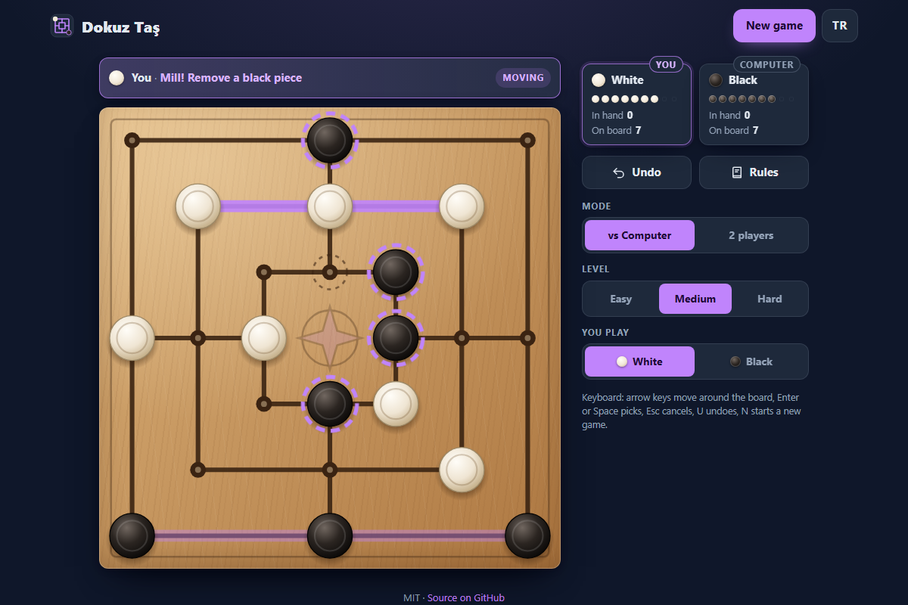

# Dokuz Taş - the ancient mill game of nine men's morris, ready to play in your browser

[](#tests)
[](LICENSE)

**▶ Play now: https://celaldrg.github.io/dokuz-tas/**



Dokuz Taş ("nine stones") is the Turkish name of nine men's morris, a strategy game played on
scratched boards for over two thousand years. Place your nine pieces, slide them along the lines,
line up three in a row to close a mill and take an opponent piece. Play a computer opponent with
three levels or a friend on the same screen, in English or Turkish.

## Features

- The complete rules: placing, moving and flying phases, mills, protected pieces, wins by material
  or blockade, draws by threefold repetition or 50 moves without a mill.
- A computer opponent with three levels (Easy, Medium, Hard); you choose White or Black. It thinks
  in a Web Worker, so the page stays responsive.
- Two players on one device.
- Legal moves highlighted, removable pieces marked after a mill, animated moves and captures.
- Tap, click or drag; the whole game is also playable from the keyboard.
- Undo (against the computer it takes back your move and its reply), a rules dialog, new game.
- English and Turkish, switchable at any time; language and settings are remembered.
- Mobile first, dark theme, respects reduced motion. Plain HTML, CSS and JavaScript modules: no
  dependencies, no build step, no tracking.

## How to play

Each player has nine pieces and White starts.

1. **Placing:** take turns putting a piece on any empty point.
2. **Moving:** once all pieces are on the board, slide one of yours along a line to the next empty point.
3. **Flying:** a player down to three pieces may move one to any empty point.

Three of your pieces on one line form a **mill**: every new mill lets you remove an opponent piece,
but not one standing in a mill unless all of their pieces are in mills. You lose with fewer than
three pieces or when you cannot move.

**Touch and mouse**

- Tap an empty point to place a piece.
- Tap one of your pieces, then a highlighted point to move it, or drag the piece there.
- After a mill, tap one of the highlighted opponent pieces to remove it.

**Keyboard**

| Key | Action |
| --- | --- |
| Tab | reach the board (one stop) and the buttons |
| Arrow keys | move around the board |
| Enter or Space | place, pick a piece or move it |
| Esc | drop the selection or close the result card |
| U | undo |
| N | new game |

## Run locally

The game uses ES modules and a module Web Worker, so it has to be served over `http://`;
opening `index.html` as a `file://` page does not work. Any static file server will do:

```sh
npx serve .
```

Then open the address it prints, for example http://localhost:3000. Add `?demo` to the URL for
the fixed mid-game position used in the screenshot.

## Tests

```sh
node --test
```

Node.js 22 or newer, nothing to install. The suites in `test/` cover:

- board geometry: the 24 points, 16 mills, neighbours and point names;
- rules: placing, moving, flying, mills, protected pieces, wins and draws;
- the game controller: removal after a mill, undo, draw bookkeeping and the demo position;
- the computer player: legal moves at every level, basic tactics, the same move for the same seed,
  and seeded computer-against-computer games that all finish;
- the seeded random number generator;
- the view model: highlights, what a tap or a drag does, status texts, point labels and keyboard navigation;
- translations: the same keys and placeholders in both languages, and every key the page uses;
- the storage helper when storage is missing or throws, and the AI client's fallback and cancel.

## Project structure

```text
index.html          page shell and the SVG board frame
style.css           theme, layout, board and piece styling
src/
  board.js          points, lines and mills of the board
  rules.js          legal steps, mills, removals, wins and draws
  game.js           game controller with undo and the demo position
  ai.js             computer player: alpha-beta search, three levels
  rng.js            seeded random numbers
  ai-worker.js      runs the computer player in a Web Worker
  ai-client.js      talks to the worker, falls back to the main thread
  view-model.js     highlights, taps, status and labels (no DOM)
  board-view.js     SVG board: pieces, animations, pointer and keyboard input
  i18n.js           English and Turkish texts
  storage.js        localStorage wrapped in try/catch
  main.js           connects everything to the page
test/               node --test suites
docs/               screenshot
```

## License

[MIT](LICENSE) © 2026 Celalettin Durgaç

## Türkçe

**▶ Hemen oyna: https://celaldrg.github.io/dokuz-tas/**

Dokuz Taş, iki bin yılı aşkın geçmişi olan klasik değirmen oyunudur. Dokuz taşını tahtaya koy,
çizgiler boyunca oynat, aynı çizgide üç taş dizerek değirmen kur ve rakibin bir taşını al. Üç
seviyeli bilgisayara ya da aynı ekranda bir arkadaşına karşı, Türkçe ya da İngilizce oyna.

### Özellikler

- Kuralların tamamı: yerleştirme, oynama ve uçma evreleri, değirmen, korunan taşlar, taş üstünlüğü
  ya da kilitlemeyle galibiyet, üç kez tekrar eden konum ya da değirmensiz 50 hamleyle beraberlik.
- Üç seviyeli bilgisayar rakip (Kolay, Orta, Zor); beyaz ya da siyah taşları sen seçersin. Bilgisayar
  Web Worker içinde düşünür, sayfa donmaz.
- Aynı cihazda iki oyuncu.
- Oynanabilir noktalar işaretlenir, değirmenden sonra alınabilecek taşlar belirir, hamleler ve
  taş almalar canlandırılır.
- Dokunarak, tıklayarak ya da sürükleyerek oynanır; oyunun tamamı klavyeyle de oynanabilir.
- Geri al (bilgisayara karşı senin hamleni ve onun cevabını birlikte geri alır), kurallar penceresi,
  yeni oyun.
- Türkçe ve İngilizce arasında istediğin an geçiş; dil ve ayarlar hatırlanır.
- Önce mobil, koyu tema, azaltılmış hareket tercihine uyar. Bağımlılık, derleme adımı ve izleme yok.

### Nasıl oynanır

Her oyuncunun dokuz taşı vardır, beyaz başlar.

1. **Yerleştirme:** Sırayla boş noktalara birer taş koyulur.
2. **Oynama:** Bütün taşlar tahtaya girince taşlarından birini çizgi boyunca yandaki boş noktaya kaydırırsın.
3. **Uçma:** Üç taşı kalan oyuncu bir taşını istediği boş noktaya götürebilir.

Aynı çizgideki üç taşın **değirmen** olur: her yeni değirmende rakibin bir taşını alırsın; rakibin
bütün taşları değirmende değilse değirmendeki taşlar alınamaz. Taşı üçten aza düşen ya da hamle
yapamayan oyuncu kaybeder.

**Dokunma ve fare:** Boş bir noktaya dokunarak taş koy. Taşını oynatmak için önce taşına, sonra
işaretli bir noktaya dokun ya da taşı oraya sürükle. Değirmenden sonra rakibin işaretli taşlarından
birine dokunarak onu al.

**Klavye:** Tab ile tahtaya gel, oklarla noktalar arasında gezin, Enter ya da Boşluk ile koy, seç ya
da oynat; Esc seçimi bırakır ya da sonuç kartını kapatır, U geri alır, N yeni oyun başlatır.

### Yerelde çalıştırma

Oyun ES modülleri ve modül Web Worker kullandığı için `http://` üzerinden sunulmalıdır; `index.html`
dosyasını `file://` ile açmak çalışmaz. Herhangi bir statik dosya sunucusu yeterli:

```sh
npx serve .
```

Sonra yazdığı adresi aç (örneğin http://localhost:3000). Ekran görüntüsündeki sabit oyun ortası
konumu için adresin sonuna `?demo` ekle.

### Testler

```sh
node --test
```

Node.js 22 ya da üstü yeterli, kurulacak bir şey yok. Testler tahta geometrisini, kuralları, oyun
denetleyicisini ve geri almayı, bilgisayar oyuncusunu (her seviyede yasal hamle, temel taktikler,
aynı tohumla aynı hamle, sonuna kadar oynanan bilgisayar maçları), tohumlu rastgele sayıları, ekran
mantığını, iki dildeki metinleri, depolama yardımcısını ve yapay zekâ istemcisini kapsar.

### Lisans

[MIT](LICENSE) © 2026 Celalettin Durgaç
